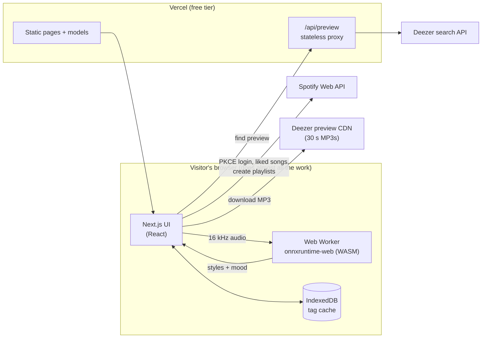

# spotify-sorter: architecture and key decisions

spotify-sorter sorts a cluttered Spotify **Liked Songs** library into genre playlists by *listening* to
each song. It works out each track's musical style (e.g. UK garage vs bassline vs drum & bass) and mood from
the audio itself, proposes playlists for review, then creates **new, private** playlists without touching
anything that already exists.

This document explains how it works and why it's built this way.

---

## 1. The problem

Spotify used to expose per-track audio features (tempo, energy, danceability) and artist genres to
developers. New apps no longer get these, and the genre tags that remain are artist-level and vague
("UK dance"). That's useless for telling apart neighbouring subgenres, which is exactly what someone with a
mixed library needs.

So the tool can't *look up* a song's genre. It has to **hear** it.

## 2. The system at a glance



The only server code is a ~50-line function that looks up preview URLs. Everything else (decoding audio,
running the neural network, grouping, talking to Spotify) happens in the visitor's browser.

## 3. What happens when someone uses it

| Step | Where | What happens |
|---|---|---|
| **Connect** | Browser ↔ Spotify | OAuth **PKCE** login: no client secret, no backend session. |
| **Scan** | Browser ↔ Spotify | Read Liked Songs 50 per request (`/me/tracks`). No per-track calls. |
| **Listen** | Browser, proxy, CDN, worker | For each song: `/api/preview` finds its Deezer preview → the browser downloads the MP3 → decodes and resamples it to 16 kHz mono → a Web Worker runs the models → tags are cached in IndexedDB. |
| **Review** | Browser | Songs are grouped into playlists by their top style. The user renames, moves or leaves songs out. |
| **Create** | Browser → Spotify | New **private** playlists only; name clashes are skipped and duplicates removed. |
| **Skips** *(optional)* | Browser only | The user loads Spotify's "Extended streaming history" export; it's parsed locally to find liked songs they always skip. |

## 4. The ML pipeline

### Model

[Essentia](https://essentia.upf.edu/)'s **Discogs-EffNet** (MTG, Universitat Pompeu Fabra): an
EfficientNet trained on Discogs metadata that outputs scores for **400 music styles**, plus a 1280-d
embedding that small "head" models turn into mood scores (relaxed, aggressive, happy, danceable).

```
30 s MP3 ──decode──▶ 16 kHz mono ──frames──▶ mel spectrogram ──patches──▶ EffNet ──▶ 400 style scores
                                                                              └──▶ embedding ──▶ mood heads
```

| Stage | Setting |
|---|---|
| Frames | 512 samples, hop 256, first frame centred on sample 0 |
| Window | Hann, not normalised |
| Spectrum | 512-point FFT → 257 bins → power |
| Mel | 96 bands, 0–8 kHz, Slaney scale, unit-area triangles |
| Compression | `log10(10000·x + 1)` |
| Model input | 128-frame patches (~2 s), hop 62; predictions averaged over patches |

### The hard part: porting the preprocessing

Essentia ships the models in a browser-ready format (ONNX), but not the code that turns audio into the
spectrogram they expect. That code exists only inside Essentia's C++ library. Its JavaScript build,
essentia.js, is **AGPL**, which would have forced the whole project under that licence.

So the feature extractor was **reimplemented from scratch**:

1. **Reverse-engineered the settings.** `ml/probe_mel.py` brute-forced every plausible combination
   (window normalisation × power/magnitude × filter normalisation × mel scale) against Essentia's own output.
   Exactly one combination matched with zero error.
2. **Wrote a numpy reference** (`ml/mel_reference.py`): filterbank error vs Essentia 9e-6, band error 3e-5.
3. **Ported it to TypeScript** (`web/src/lib/audio/mel.ts`), with a hand-written radix-2 FFT and no
   dependencies.

### Proving it's correct

Accuracy is verified at three levels:

| Test | Result |
|---|---|
| numpy + ONNX vs Essentia + TensorFlow, 20 real tracks (`ml/parity.py`) | max error **1e-5** |
| TypeScript vs a fixture generated from a synthetic signal (`web/test/mel.test.ts`, runs in CI) | mel < 1e-4, model outputs < 1e-3 |
| Full browser pipeline vs Python, 12 real tracks (`/dev/parity`, including a production build) | **12/12** identical top style |

The fixture uses a synthetic signal (kicks, hats and a chirp), so no copyrighted audio is committed to the
repo.

**A side discovery:** EffNet's built-in `activations` output is *identical* to Essentia's separate
`genre_discogs400` model, which isn't published in a browser format. So no model conversion was needed,
and only official, unmodified files are used. That matters because the models' licence forbids
distributing modified versions.

### Speed

About **0.75 s per song** on a recent Mac (fetch + decode + inference), so a 760-song library takes
roughly 10 minutes. Downloading and decoding run up to three songs ahead of the model, which runs in a
single Web Worker so the UI never freezes. Results are cached per track in IndexedDB, so a run can be
paused, the tab closed, and the run resumed later.

## 5. Key design decisions

### Run the models in the browser, not on a server
- **Chosen:** onnxruntime-web (WebAssembly) in a Web Worker.
- **Rejected:** Python + TensorFlow on Vercel (TensorFlow alone exceeds Vercel's ~250 MB function limit);
  a Python worker on Hugging Face Spaces, Modal or Fly (works, but it's an always-on service to run, pay for
  and secure).
- **Why:** free to host, scales with users at no cost, and private by design: libraries and listening data
  never leave the visitor's device.
- **Cost:** a ~20 MB model download (cached after the first visit) and ~15 MB of WebAssembly runtime.

### Use Deezer for audio, through a tiny proxy
- Spotify no longer gives new apps preview URLs; Deezer still serves 30-second previews.
- Deezer's *search* API doesn't allow browser requests (no CORS headers), but its *CDN* does. So only the
  search goes through `/api/preview`, and the MP3s go straight to the browser.
- Previews are matched by **artist + title on Deezer**, not by looking each track up on Spotify. The first
  version did per-track Spotify lookups and got the app **blocked for ~23 hours after ~760 calls**. The
  current design makes no per-track Spotify calls at all.

### Bring-your-own Spotify Client ID, with an optional built-in one
- Spotify "development mode" apps only work for a short list of accounts the owner adds by hand. Wider
  access requires Spotify's extended quota, which personal projects rarely get.
- So every visitor can paste their own free Client ID (a guided, ~5-minute setup). The owner can also bake
  in their own ID for friends on their list; if Spotify rejects someone with "user not registered", the app
  explains why and switches them to their own ID.
- PKCE means no client secret is needed anywhere.

### "Your library is sacred": additive, reviewable writes only
- Never edits, reorders or deletes anything that exists. It only creates new **private** playlists.
- A name clash with an existing playlist is skipped, never overwritten.
- Everything is shown before it's created; left-out songs stay visible, struck through, and can be put back.
- The minimum OAuth scopes are requested: read library, read private playlists, modify private playlists.

### Group by audio, and say when it's unsure
- Each song goes to the playlist matching its **top style**, via an ordered rule list
  (`web/src/lib/grouping.ts`). Specific rules come before broad ones, with optional mood gates (e.g. "Chill"
  excludes aggressive tracks).
- Groups too small to label readably fold into "Everything else".
- The UI shows each song's top styles with confidence and a plain-English explanation of each style, so
  users learn the genre names. Moving any song is one click.
- **Honest limitation:** audio can't tell UK rap from US rap. The CLI version supports artist-based rules
  for that.

## 6. Design: the sound-system stack

The visual direction came from the audience's culture, not the category default (a grey sidebar with a
green accent and a table). Playlists are drawn as **speaker cabinets in a UK sound-system stack**.

- **The signature move is functional:** each cabinet's height is *exactly* proportional to its song count,
  so the stack is the navigation, a chart and the progress display at once. During Listen it fills live
  towards a dashed outline of the full library's height.
- **Rules from `DESIGN.md`:** a seven-step warm-black ramp is the only set of neutrals. Hazard yellow is
  reserved for actions. Each playlist gets its own colour (held for the whole session). Stencil type
  appears only on cabinet labels. Motion is height changes only.
- **Process:** directions were generated and reviewed with design tooling (Impeccable, a design-council
  critique), then checked by an independent review agent over two rounds of fixes. The remaining known
  issue: with more than ~7 playlists, some cabinets can share a colour family.
- Accessibility: keyboard-operable throughout, visible focus, AA contrast, reduced-motion respected,
  status announced to screen readers during long runs.

## 7. Security model

| Threat | Mitigation |
|---|---|
| Leaked server secrets | There are none. PKCE login, no backend storage, no client secret. |
| XSS stealing the Spotify token (stored in the browser) | Strict **CSP**: scripts only from this site; connections only to Spotify and Deezer's CDN. React escapes all output and no HTML is injected. |
| Clickjacking | `frame-ancestors 'none'`, `X-Frame-Options: DENY`. |
| OAuth code leaking via Referer | `Referrer-Policy: no-referrer` on `/callback`; the PKCE verifier and `state` are checked. |
| Proxy abuse / SSRF | `/api/preview` only calls Deezer's fixed host, caps input length, rejects cross-site requests, and is rate-limited (300/min per IP, about 3× a real run). Clients back off on 429, so real use isn't slowed. A Vercel Firewall rule covers traffic spread across instances. |
| Supply chain | `npm audit` (production dependencies) is clean; CI runs on every PR. |

**Trade-off:** the CSP allows inline scripts because the pages are statically pre-rendered. Next.js nonces
would force every page to be rendered dynamically. That's acceptable because the app never renders user
data as HTML.

## 8. Repository map

```
cli/      Python CLI: the original tool (Spotify API + Essentia/TensorFlow), still useful for power users
ml/       Reference pipeline: mel port, probe, parity tests, fixture and demo-data generators
web/      Next.js app
  src/lib/audio/   mel.ts (feature extractor), tagger.ts (model runner), tag.worker.ts, decode.ts
  src/lib/         spotify.ts (PKCE + API), grouping.ts (rules, plan, colours), runner.ts (pipeline),
                   skips.ts (export analysis), cache.ts (IndexedDB), server/rateLimit.ts
  src/app/         page, /callback, /api/preview, /dev/parity (dev-only)
  src/components/  App shell, Stack (cabinets), TrackList, Panels, Player, SkipsPanel
  test/            Vitest: mel parity, grouping, colours, skips, rate limiting
  scripts/         fetch-models.sh (retrying download of the official models), copy-ort.mjs
DESIGN.md / PRODUCT.md   design system and product brief
```

## 9. Engineering practice

- **Monorepo** with a feature branch and PR per change, squash merges, and CI (lint, typecheck, tests, production build)
  on every PR.
- **Test the risky parts:** numeric parity against the reference implementation, grouping and colour
  stability, skip parsing, the rate limiter, and detection of Spotify's "user not registered" error.
- **Licensing handled deliberately:**
  - Code is MIT.
  - Models are CC BY-NC-ND: downloaded at build time, never committed, never modified.
  - The stencil font is SIL OFL and self-hosted.
  - The AGPL essentia.js was avoided by porting the preprocessing.
- **Privacy:** the repo history was scrubbed of personal data before going public, and the demo uses a
  generic sample library, not anyone's real one.

## 10. Talking points (portfolio summary)

- *"Spotify took away audio features, so I made the app listen to the music instead: a neural network
  running entirely in the browser."*
- *"I reverse-engineered a C++ audio feature extractor, ported it to TypeScript, and proved it matches the
  original to within 0.00001."*
- *"No backend to run: free to host, and users' data never leaves their device."*
- *"Designed around trust: it only ever creates new private playlists, and you review every song first."*
- *"The UI's signature, a speaker stack whose cabinet heights are exact song counts, is also the chart, the
  navigation and the progress bar."*

## 11. Limits and next steps

- Some songs have no Deezer preview; they're listed as untagged.
- 30-second previews can miss a track's drop or change of style.
- Style labels are model guesses; review is part of the design, not an afterthought.
- Next: artist rules in the web UI (UK vs US rap), adding to existing tool-made playlists, skip-weighted
  cleanup suggestions, and per-song BPM/key display.
